# Servidor web Nginx

**Despliegue de Aplicaciones Web** · Sergio Segoviano Gálvez · 2º DAW

## Índice

1. [Investigación](#investigación)
    1. [Qué es Nginx](#qué-es-nginx)
    2. [Diferencias con Apache](#diferencias-con-apache)
    3. [Instalación y ejecución en Ubuntu](#instalación-y-ejecución-en-ubuntu)
2. [Implementación](#implementación)
    1. [Comprobación de los puertos](#comprobación-de-los-puertos)
    2. [Instalación de Nginx](#instalación-de-nginx)
    3. [Configuración del servidor (server block)](#configuración-del-servidor-server-block)
    4. [Validación y aplicación de cambios](#validación-y-aplicación-de-cambios)
3. [Verificación](#verificación)
4. [Problemas surgidos](#problemas-surgidos)
5. [Banco de pruebas](#banco-de-pruebas)
6. [Conclusiones](#conclusiones)
7. [Bibliografía](#bibliografía)

## Investigación

### Qué es Nginx

Nginx (se pronuncia *engine-x*) es un servidor web de código abierto que también se usa como proxy inverso, balanceador de carga y caché. Lo creó Igor Sysoev y se publicó en 2004 para resolver el problema de atender miles de conexiones simultáneas con pocos recursos. Para ello usa una arquitectura **asíncrona y dirigida por eventos**.

Funciona con un **proceso maestro** y varios **procesos trabajadores** (*workers*):

| Proceso | Función |
| --- | --- |
| Maestro (*master*) | Lee y valida la configuración, abre los puertos y crea y controla los workers. Se ejecuta como root. |
| Trabajadores (*workers*) | Atienden las peticiones de los clientes. Cada uno gestiona miles de conexiones en un bucle de eventos, sin quedarse bloqueado esperando a un cliente lento. Se ejecutan como `www-data`. |

Normalmente se configura un worker por cada núcleo de CPU (`worker_processes auto;`). Al recargar la configuración, el maestro comprueba la nueva y, si es correcta, crea workers nuevos y cierra los antiguos cuando terminan sus peticiones. Si tiene errores, sigue funcionando con la configuración anterior. Por eso se puede recargar sin cortar el servicio.

### Diferencias con Apache

| Aspecto | Apache | Nginx |
| --- | --- | --- |
| Arquitectura | Basada en procesos o hilos mediante los MPM (prefork, worker, event): cada conexión ocupa un proceso o un hilo | Dirigida por eventos: pocos workers, cada uno atiende muchas conexiones a la vez |
| Consumo de memoria | Crece con el número de conexiones | Bajo y estable aunque haya muchas conexiones |
| Contenido estático | Bueno | Muy rápido, es su punto fuerte |
| Contenido dinámico (PHP) | Lo puede procesar dentro del propio servidor con `mod_php` | Lo pasa a un procesador externo por FastCGI, normalmente PHP-FPM |
| Configuración por directorio | Ficheros `.htaccess` en cada carpeta, sin reiniciar | No admite `.htaccess`: toda la configuración está centralizada |
| Módulos | Se cargan y descargan fácilmente (`a2enmod`) | La mayoría van incluidos al compilar |
| Uso habitual | Alojamientos compartidos y aplicaciones que dependen de `.htaccess` | Webs con mucho tráfico, proxy inverso delante de otros servidores |

Equivalencias en Ubuntu:

| Acción | Apache | Nginx |
| --- | --- | --- |
| Configuración principal | `/etc/apache2/apache2.conf` | `/etc/nginx/nginx.conf` |
| Sitios | `sites-available` y `sites-enabled` | `sites-available` y `sites-enabled` |
| Unidad de configuración de un sitio | VirtualHost | Server block |
| Activar un sitio | `a2ensite sitio.conf` | `ln -s` del fichero a `sites-enabled` |
| Desactivar un sitio | `a2dissite sitio.conf` | `unlink` del enlace en `sites-enabled` |
| Comprobar la configuración | `apache2ctl configtest` | `nginx -t` |
| Registros | `/var/log/apache2/` | `/var/log/nginx/` |

Los dos no son excluyentes: es habitual poner Nginx delante como proxy inverso, sirviendo el contenido estático, y pasar el dinámico a Apache.

### Instalación y ejecución en Ubuntu

Nginx está en los repositorios oficiales de Ubuntu, así que se instala con `apt`. En Ubuntu 24.04 la versión es la 1.24.0. Al instalarse queda como servicio de systemd, arrancado y activado para que se inicie con el sistema.

| Comando | Para qué sirve |
| --- | --- |
| `sudo apt install nginx` | Instalar Nginx |
| `sudo systemctl status nginx` | Ver el estado del servicio |
| `sudo systemctl start` / `stop` / `restart nginx` | Arrancar, parar o reiniciar |
| `sudo systemctl reload nginx` | Aplicar cambios sin cortar las conexiones |
| `sudo systemctl enable` / `disable nginx` | Activar o quitar el arranque automático |
| `sudo nginx -t` | Comprobar la sintaxis de la configuración |
| `nginx -v` | Ver la versión |

Ficheros y carpetas principales:

| Ruta | Contenido |
| --- | --- |
| `/etc/nginx/nginx.conf` | Configuración general |
| `/etc/nginx/sites-available/` | Configuración de todos los sitios |
| `/etc/nginx/sites-enabled/` | Enlaces a los sitios activos |
| `/var/www/html/` | Carpeta del sitio por defecto |
| `/var/log/nginx/` | Registros `access.log` y `error.log` |

Por defecto, Nginx escucha en el **puerto 80**, el mismo que Apache. Si los dos están en la misma máquina, solo uno de ellos puede usar cada puerto.

## Implementación

Se ha hecho en la misma máquina virtual de las prácticas anteriores: Ubuntu 24.04 LTS en VirtualBox. En ella ya funcionan Apache, con el sitio `sergio.example.com` en los puertos 80 y 443, y dos contenedores de Docker en los puertos 8080 y 8081.

### Comprobación de los puertos

Antes de instalar se comprueba qué puertos están ocupados:

```bash
docker start appserver webserver
sudo ss -tlnp | grep -E ':80 |:443|:808'
```

Apache ocupa el 80 y el 443, y `docker-proxy` el 8080 y el 8081. Por eso, el sitio de Nginx se configurará en el puerto **8082**, para que los tres funcionen a la vez sin conflictos.

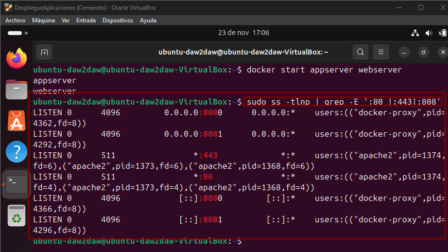

### Instalación de Nginx

Se para Apache para liberar el puerto 80, porque al instalarse Nginx intenta arrancar en él con su sitio por defecto. Después se instala:

```bash
sudo systemctl stop apache2
sudo apt update && sudo apt install nginx -y
```

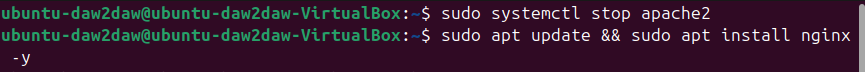

Se comprueban la versión y el estado del servicio:

```bash
nginx -v
sudo systemctl status nginx
```

Nginx 1.24.0 queda activo (`active (running)`) y habilitado para el arranque. En el estado se ven el proceso maestro (`nginx: master process`) y un proceso trabajador (`nginx: worker process`).

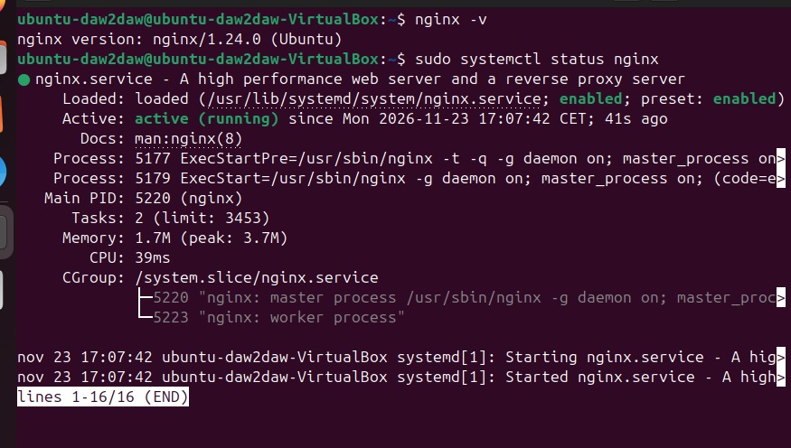

### Configuración del servidor (server block)

En Nginx, lo que en Apache es un VirtualHost se llama **server block**.

**Desactivar el sitio por defecto y crear la carpeta del sitio.** Se quita el sitio por defecto para liberar el puerto 80 y se crea la carpeta del nuevo sitio:

```bash
sudo unlink /etc/nginx/sites-enabled/default
sudo mkdir -p /var/www/nginx-sergio
```

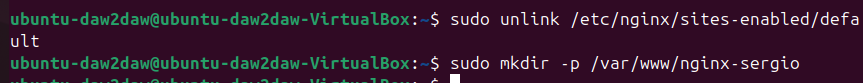

**Crear la página del sitio:**

```bash
sudo nano /var/www/nginx-sergio/index.html
```

Es una página sencilla con el nombre del autor, el ciclo y la localidad. Lleva `<meta charset="UTF-8">` para que las tildes se muestren correctamente.

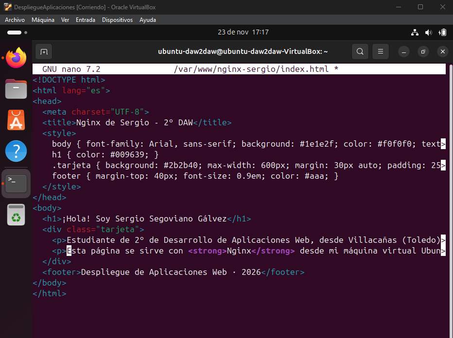

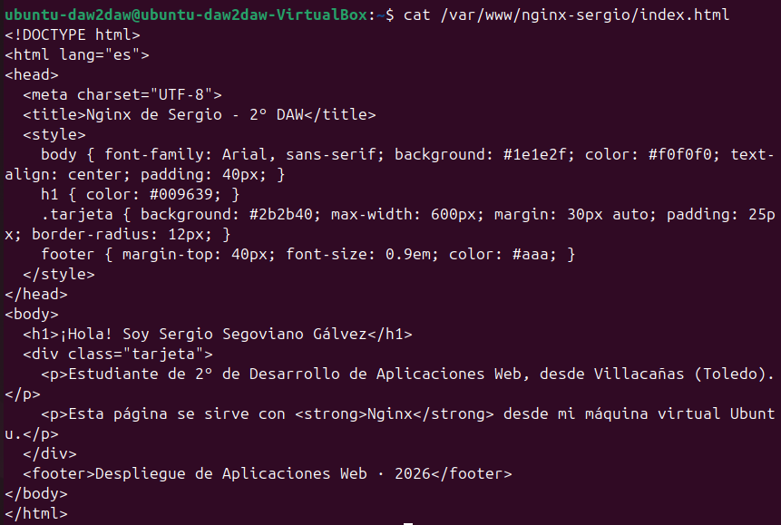

**Crear el server block:**

```bash
sudo nano /etc/nginx/sites-available/sergio-nginx
```

```nginx
server {
    listen 8082;
    listen [::]:8082;

    server_name nginx.example.com;

    root /var/www/nginx-sergio;
    index index.html;

    access_log /var/log/nginx/sergio-nginx.access.log;
    error_log /var/log/nginx/sergio-nginx.error.log;

    location / {
        try_files $uri $uri/ =404;
    }
}
```

| Directiva | Función |
| --- | --- |
| `listen 8082` / `listen [::]:8082` | Puerto en el que escucha, en IPv4 e IPv6 |
| `server_name` | Dominio del sitio, equivale a `ServerName` en Apache |
| `root` | Carpeta de la web, equivale a `DocumentRoot` |
| `index` | Fichero que se sirve al pedir una carpeta |
| `access_log` / `error_log` | Registros propios del sitio |
| `location /` con `try_files` | Busca el fichero pedido o la carpeta; si no existe, devuelve un error 404 |

Cada directiva termina en punto y coma, y los bloques van entre llaves.

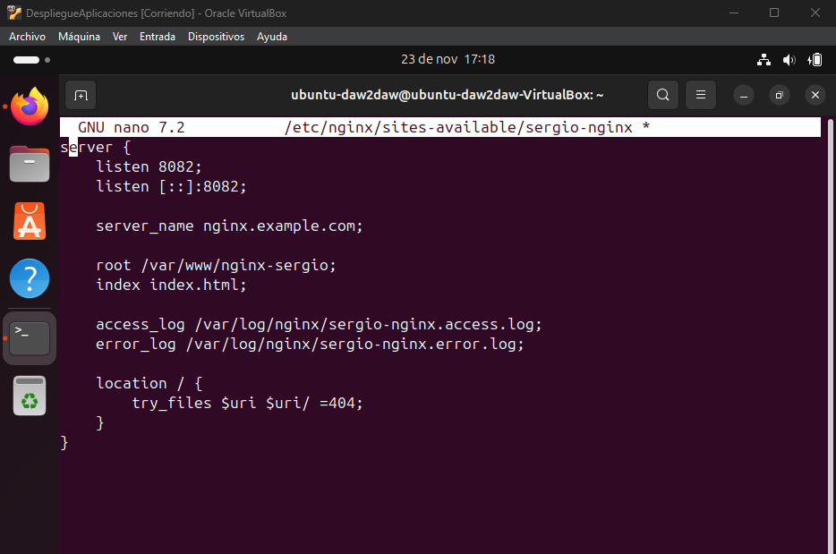

**Activar el sitio con un enlace simbólico.** Nginx no tiene un comando como `a2ensite`, que es una herramienta propia de Apache en Debian y Ubuntu. Para activar un sitio en Nginx se crea a mano un **enlace simbólico** desde `sites-enabled` hacia el fichero de configuración de `sites-available`:

```bash
sudo ln -s /etc/nginx/sites-available/sergio-nginx /etc/nginx/sites-enabled/ && ls -l /etc/nginx/sites-enabled/
```

- **`sites-available`** guarda la configuración de todos los sitios, estén activos o no.
- **`sites-enabled`** contiene solo enlaces a los sitios activos. Nginx carga únicamente lo que hay en esta carpeta.
- **`ln -s`** crea un enlace simbólico: un acceso directo que apunta al fichero original. Así solo hay un fichero, y cualquier cambio en `sites-available` se aplica directamente.

Para desactivar un sitio se borra el enlace con `unlink`, sin tocar el fichero original. Es lo que se ha hecho con el sitio por defecto.

En el `ls -l` se ve que en `sites-enabled` solo queda el enlace `sergio-nginx -> /etc/nginx/sites-available/sergio-nginx`. La `l` al principio de los permisos indica que es un enlace.

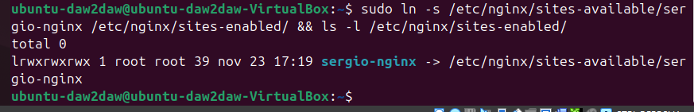

**Añadir el dominio a /etc/hosts.** Como `nginx.example.com` no es un dominio real, se añade a `/etc/hosts` apuntando a la propia máquina:

```bash
sudo nano /etc/hosts
```

```
127.0.0.1 nginx.example.com
```

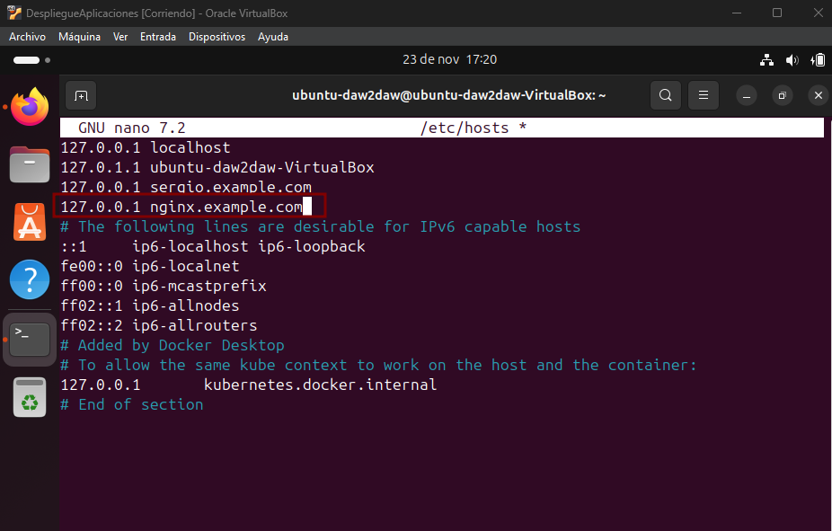

### Validación y aplicación de cambios

```bash
sudo nginx -t
sudo systemctl reload nginx
sudo systemctl start apache2
sudo ss -tlnp | grep -E 'nginx|apache2'
```

- `nginx -t` comprueba la sintaxis de toda la configuración y devuelve `syntax is ok` y `test is successful`.
- `reload` aplica los cambios sin parar el servicio.
- Se vuelve a arrancar Apache, que ya puede usar el puerto 80 porque Nginx ha dejado de escuchar en él.
- `ss` muestra que **Nginx escucha en el 8082** y **Apache en el 80 y el 443**, los dos a la vez.

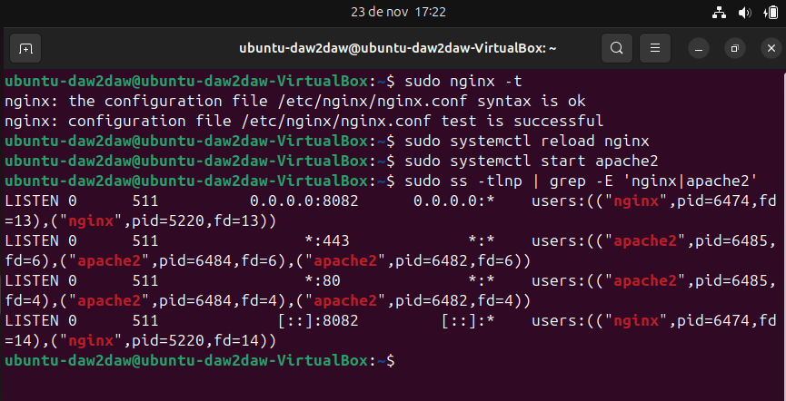

## Verificación

```bash
curl -I http://nginx.example.com:8082
curl -I http://nginx.example.com:8082/noexiste
curl -I http://sergio.example.com
```

- **Sitio de Nginx:** `HTTP/1.1 200 OK` con `Server: nginx/1.24.0 (Ubuntu)`. El tamaño (`Content-Length: 804`) y la fecha corresponden al `index.html` creado en esta práctica.
- **Página que no existe:** `404 Not Found` devuelto por Nginx, gracias a `try_files ... =404`.
- **Sitio de Apache:** sigue funcionando y devuelve su `301` hacia HTTPS con `Server: Apache/2.4.58 (Ubuntu)`.

Con esto se comprueba que Nginx sirve el nuevo sitio y que convive con Apache en la misma máquina.

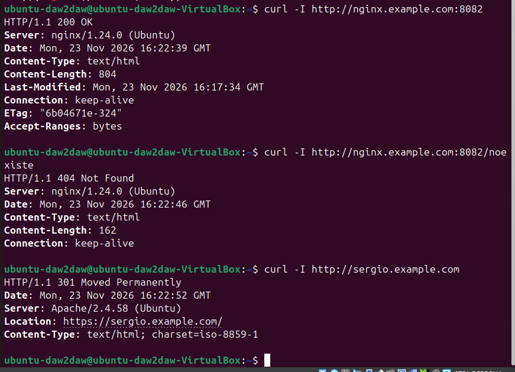

## Problemas surgidos

**El navegador mostraba la página de Apache.** Después de instalar Nginx, el navegador seguía mostrando en `http://localhost` la página «Apache2 Ubuntu Default Page», aunque se había parado Apache y borrado el historial. Parecía que la petición la seguía atendiendo Apache.

**Causa:** el sitio por defecto de Nginx usa la misma carpeta que Apache, `/var/www/html`. Allí seguía el `index.html` de bienvenida que creó Apache al instalarse, y Nginx lo sirve antes que su propia página, `index.nginx-debian.html`.

**Comprobación con curl:**

```bash
curl -I http://localhost
```

La cabecera `Server: nginx/1.24.0 (Ubuntu)` demuestra que quien responde es Nginx. Además, el `Content-Length: 10671` y la fecha `Last-Modified` del 10 de noviembre corresponden al fichero que creó Apache en la práctica de configuración.

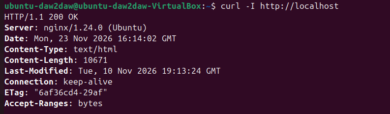

**Solución:** no era un fallo de Nginx. La página propia de Nginx se puede ver en `http://localhost/index.nginx-debian.html`. Al desactivar el sitio por defecto y crear un server block con su propia carpeta (`/var/www/nginx-sergio`), el problema desaparece.

| Problema | Causa | Solución |
| --- | --- | --- |
| El navegador mostraba la página de Apache con Nginx. | Nginx servía el `index.html` de Apache en `/var/www/html`. | Comprobar con `curl -I` quién responde y usar un server block con su propia carpeta. |
| Apache y Nginx usan el puerto 80. | Los dos escuchan en el 80 por defecto. | Parar Apache al instalar, quitar el sitio por defecto de Nginx y usar el puerto 8082. |

## Banco de pruebas

Pruebas realizadas en la máquina virtual (Ubuntu 24.04, Nginx 1.24.0, Apache 2.4.58, curl).

| N.º | Prueba | Resultado esperado | Resultado obtenido |
| --- | --- | --- | --- |
| 1 | `systemctl status nginx` | Servicio activo | Correcto |
| 2 | `curl -I http://localhost` (antes del server block) | Responde Nginx | Correcto, pero con la página de Apache |
| 3 | `nginx -t` | syntax is ok / test is successful | Correcto |
| 4 | `ss -tlnp` | Nginx en el 8082, Apache en el 80 y el 443 | Correcto |
| 5 | `curl -I http://nginx.example.com:8082` | 200 OK, Server: nginx | Correcto |
| 6 | `curl -I http://nginx.example.com:8082/noexiste` | 404 Not Found | Correcto |
| 7 | `curl -I http://sergio.example.com` | Apache sigue respondiendo | Correcto |

## Conclusiones

Se ha instalado Nginx en Ubuntu y se ha configurado un server block propio en el puerto 8082, que sirve una página creada para la práctica. Nginx funciona a la vez que Apache y que los contenedores de Docker, cada uno en su puerto.

La configuración de Nginx se parece a la de Apache: también usa `sites-available` y `sites-enabled`. Las diferencias principales son la sintaxis, con bloques entre llaves y directivas terminadas en punto y coma, y que los sitios se activan con un enlace simbólico en lugar de con `a2ensite`. `nginx -t` es muy útil para comprobar la configuración antes de aplicarla.

**Dificultades encontradas:** al principio parecía que Nginx no funcionaba, porque el navegador seguía mostrando la página de Apache. Con `curl -I` se vio que el servidor que respondía era Nginx y que solo estaba sirviendo el fichero de bienvenida de Apache. Esto demuestra que no hay que fiarse solo de lo que muestra la página: hay que mirar las cabeceras para saber qué servidor responde. También hubo que planificar los puertos, porque Apache y los contenedores de Docker ya ocupaban el 80, el 443, el 8080 y el 8081.

## Bibliografía

- nginx.org. *Beginner's Guide*. https://nginx.org/en/docs/beginners_guide.html (consultado el 23/11/2026).
- DigitalOcean. *Apache vs Nginx: Practical Considerations*. https://www.digitalocean.com/community/tutorials/apache-vs-nginx-practical-considerations (consultado el 23/11/2026).
- DigitalOcean. *How To Install Nginx on Ubuntu*. https://www.digitalocean.com/community/tutorials/how-to-install-nginx-on-ubuntu-22-04 (consultado el 23/11/2026).
