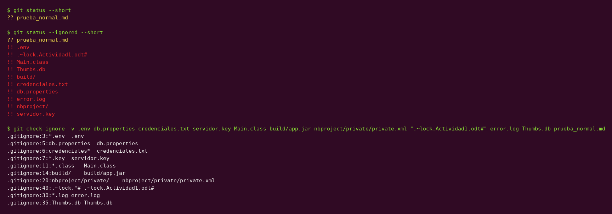
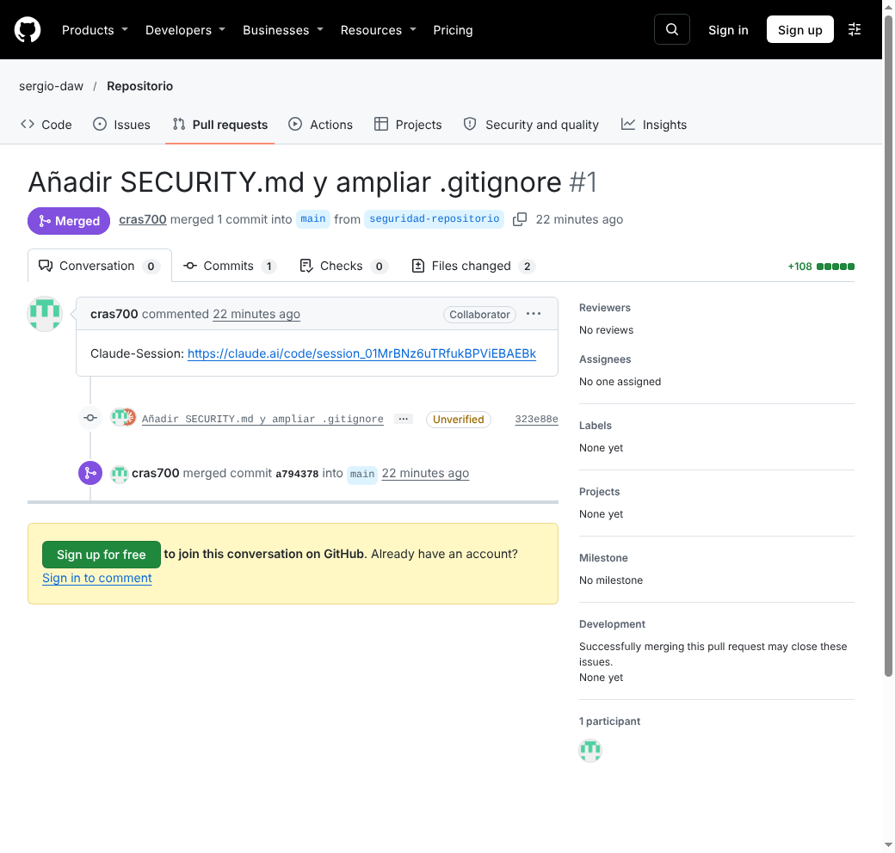
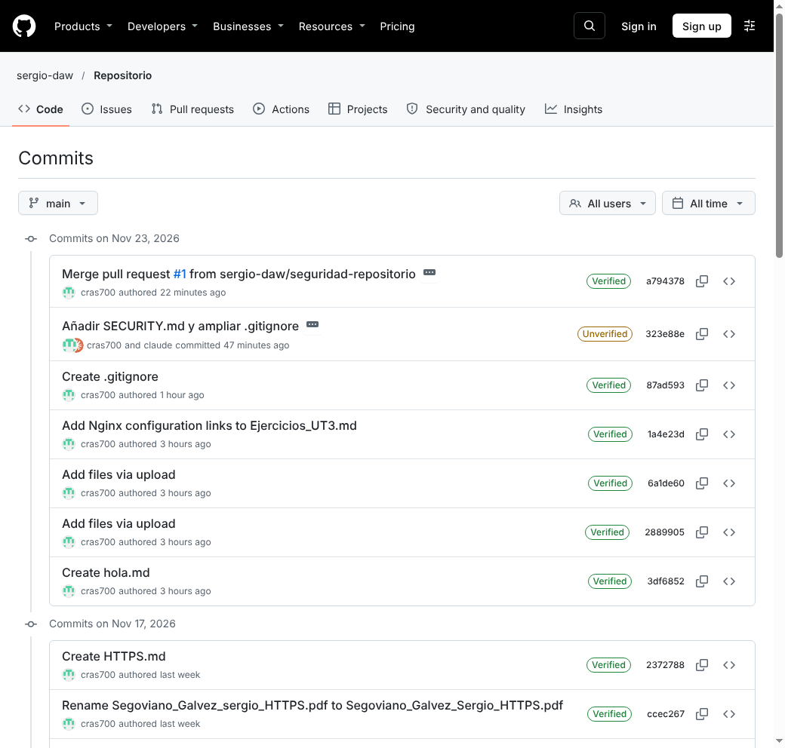

# Política de seguridad del repositorio

**Despliegue de Aplicaciones Web** · Sergio Segoviano Gálvez · 2º DAW

Este documento explica cómo se protege la información de este repositorio: qué ficheros no se suben, quién puede acceder y con qué permisos, qué buenas prácticas se siguen y cómo se recupera el repositorio si se pierden datos.

## Índice

1. [Protección de datos sensibles](#1-protección-de-datos-sensibles)
2. [Accesibilidad y permisos](#2-accesibilidad-y-permisos)
3. [Buenas prácticas de seguridad](#3-buenas-prácticas-de-seguridad)
4. [Recuperación ante pérdida de datos](#4-recuperación-ante-pérdida-de-datos)
5. [Evidencias](#5-evidencias)

## 1. Protección de datos sensibles

El fichero [`.gitignore`](.gitignore) está en la **raíz del repositorio**, por lo que sus reglas se aplican a todas las carpetas. Indica a Git qué ficheros no debe rastrear ni subir.

### Por qué se excluye cada grupo

| Grupo | Ejemplos | Motivo |
| --- | --- | --- |
| Datos sensibles | `.env`, `*.key`, `*.pem`, `credenciales*`, `config.properties`, `db.properties` | Contienen contraseñas, claves de API o certificados. Este repositorio es **público**: cualquiera podría leerlos y usarlos. |
| Compilados y binarios | `*.class`, `*.jar`, `*.war`, `build/`, `dist/`, `target/`, `out/` | Se generan al compilar y se pueden volver a crear en cualquier momento. Git no puede comparar versiones de un binario y hacen crecer mucho el repositorio. |
| Configuración local del IDE | `nbproject/private/`, `.idea/`, `.vscode/`, `*.iml` | Son ajustes de cada persona (rutas de su equipo, preferencias del editor). Si se suben, los miembros del equipo se sobrescriben la configuración entre ellos. |
| Temporales y registros | `*.log`, `*.tmp`, `*.bak`, `*~`, `*.swp`, `*.orig` | Los crean los programas mientras se trabaja. No aportan nada y los logs pueden contener rutas o datos de usuarios. |
| Bloqueos de LibreOffice y Office | `.~lock.*#`, `~$*` | Aparecen mientras un `.odt` o `.docx` está abierto. Como en este repositorio se guardan memorias en esos formatos, es fácil subirlos por error. |
| Ficheros del sistema operativo | `.DS_Store`, `Thumbs.db`, `desktop.ini` | Los crean Windows y macOS para guardar miniaturas y ajustes de carpetas. No tienen relación con el proyecto. |

### Limitaciones del `.gitignore`

- **No borra lo que ya está subido.** Si un fichero estaba en el repositorio antes de añadir la regla, Git lo sigue rastreando. Hay que quitarlo con `git rm --cached fichero`, o borrarlo desde la web de GitHub.
- **No borra el historial.** Si se sube una contraseña y después se borra, sigue visible en los commits anteriores. La única medida segura es **cambiar esa contraseña** inmediatamente.
- **Solo actúa al trabajar con Git.** Si se suben ficheros arrastrándolos en la web de GitHub (*Add file → Upload files*), el `.gitignore` no los filtra. Hay que revisar lo que se sube antes de confirmar el commit.

## 2. Accesibilidad y permisos

### Tipos de cuenta en GitHub

En un repositorio de una **cuenta personal** solo existen dos niveles: el propietario y los colaboradores, y todos los colaboradores tienen permiso de escritura. Para asignar permisos distintos (lectura, escritura, administración), el repositorio tiene que pertenecer a una **organización**. Las organizaciones son gratuitas en GitHub.

### Roles de un repositorio de organización

| Rol | Qué puede hacer |
| --- | --- |
| **Read** | Ver y clonar el repositorio, abrir issues y comentar. No puede subir cambios. |
| **Triage** | Lo mismo que Read, y además organizar issues y pull requests (etiquetas, asignaciones, cerrarlos). |
| **Write** | Subir cambios, crear ramas y fusionar pull requests. |
| **Maintain** | Lo mismo que Write, y además gestionar el repositorio sin acciones peligrosas: descripción, temas, wikis, opciones de fusión. |
| **Admin** | Control total: configuración, colaboradores, ramas protegidas, visibilidad, transferir o borrar el repositorio. |

### Configuración del repositorio

- El repositorio se ha transferido de la cuenta personal `cras700` a la organización **`sergio-daw`**, para poder asignar roles distintos a cada colaborador.
- El repositorio es **público**: cualquier persona puede verlo y clonarlo, pero solo los colaboradores con rol Write o superior pueden modificarlo.

### Permisos de cada rol

No se ha podido contar con un compañero para hacer las pruebas con otra cuenta. La cuenta `cras700` es la propietaria de la organización y tiene siempre permisos de administrador, por lo que no sirve para probar los roles Read y Write. Por eso esta tabla recoge lo que permite cada rol según la documentación oficial de GitHub:

| Acción | Read | Write | Admin |
| --- | --- | --- | --- |
| Ver y clonar el repositorio | ✓ | ✓ | ✓ |
| Abrir issues y comentar | ✓ | ✓ | ✓ |
| Editar un fichero y hacer commit | ✗ | ✓ | ✓ |
| Subir directamente a `main` con la rama protegida | ✗ | ✗ | ✓ (si se permite saltarse la regla) |
| Abrir un pull request desde una rama del repositorio | ✗ | ✓ | ✓ |
| Fusionar un pull request | ✗ | ✓ | ✓ |
| Ver la pestaña *Settings* | ✗ | ✗ | ✓ |
| Gestionar colaboradores y ramas protegidas | ✗ | ✗ | ✓ |
| Borrar o transferir el repositorio | ✗ | ✗ | ✓ |

Sí se ha comprobado el caso de un usuario **sin ningún permiso**: al intentar editar un fichero de `main` sin haber iniciado sesión, GitHub redirige a la pantalla de inicio de sesión y no permite hacer cambios.

### Permiso adecuado para cada rol del equipo

Se aplica el **principio de mínimo privilegio**: cada persona recibe solo el acceso que necesita para su trabajo.

| Rol en el equipo | Permiso | Motivo |
| --- | --- | --- |
| Profesor, cliente o invitado | Read | Solo necesita revisar el trabajo. |
| Tester o QA | Triage | Abre y clasifica errores, pero no cambia el código. |
| Desarrollador | Write | Sube su trabajo en ramas y abre pull requests. |
| Jefe de proyecto | Maintain | Organiza el repositorio sin poder borrarlo ni cambiar la seguridad. |
| Responsable del repositorio | Admin | Una o dos personas como máximo, para gestionar accesos y seguridad. |

## 3. Buenas prácticas de seguridad

- **Rama `main` protegida.** Nadie sube directamente a `main`: los cambios se hacen en otra rama y entran mediante un pull request. En repositorios públicos esta opción es gratuita. La regla se configura en *Settings → Branches → Add classic branch protection rule* así:

  | Opción | Valor |
  | --- | --- |
  | Branch name pattern | `main` |
  | Require a pull request before merging | Activada, con 1 aprobación |
  | Dismiss stale pull request approvals when new commits are pushed | Activada |
  | Require conversation resolution before merging | Activada |
  | Allow force pushes | Desactivada |
  | Allow deletions | Desactivada |

  La opción *Do not allow bypassing the above settings* se deja desactivada porque el repositorio tiene un único administrador, que no puede aprobar sus propios pull requests. En un equipo real convendría activarla, para que nadie, ni el administrador, pueda saltarse la revisión.
- **Revisión de pull requests.** Cada pull request necesita al menos una aprobación de otra persona antes de fusionarse. Así se detectan errores y datos sensibles antes de que lleguen a `main`.
- **Autenticación en dos pasos (2FA)** activada en todas las cuentas con acceso al repositorio.
- **Mínimo privilegio** en los permisos, revisando cada cierto tiempo la lista de colaboradores y quitando el acceso a quien ya no participa.
- **Nunca subir secretos.** Las contraseñas van en ficheros excluidos por el `.gitignore`. Se puede subir un ejemplo sin valores reales, como `.env.example`.
- **Alertas de seguridad de GitHub.** En *Settings → Code security* se pueden activar *Secret scanning*, que avisa si se sube una clave conocida, y *Dependabot*, que avisa de librerías con vulnerabilidades.
- **Commits pequeños y con mensajes claros**, para saber qué cambió en cada momento y poder deshacerlo fácilmente.

## 4. Recuperación ante pérdida de datos

| Situación | Cómo se recupera |
| --- | --- |
| Un commit con errores | `git revert <commit>` crea un commit nuevo que deshace los cambios sin reescribir el historial. Desde la web, el pull request fusionado tiene un botón *Revert*. |
| Un fichero borrado por error | Se recupera de un commit anterior con `git checkout <commit> -- fichero`, o desde la web abriendo el historial del fichero. |
| Una rama borrada o un `reset` equivocado | `git reflog` guarda los movimientos recientes de cada clon local y permite volver a cualquier punto. Las ramas borradas en un pull request se pueden restaurar desde la web. |
| Pérdida del repositorio en GitHub | Cada clon local es una **copia completa** con todo el historial, así que se puede volver a subir desde cualquier equipo. GitHub también permite restaurar durante un tiempo un repositorio borrado, desde *Settings → Repositories → Deleted repositories*. |
| Copia de seguridad periódica | `git clone --mirror https://github.com/cras700/Repositorio.git` guarda una copia exacta (todas las ramas y etiquetas) en otro disco o servicio. |
| Versiones importantes | Se marcan con etiquetas (`git tag`) o *Releases* en GitHub, para volver fácilmente a una entrega concreta. |

Con la rama protegida y la revisión de pull requests se evita la mayoría de los errores graves. Con varias copias del repositorio, en GitHub, en los equipos del equipo de trabajo y en una copia espejo, se puede recuperar aunque falle cualquiera de ellas.

## 5. Evidencias

### Prueba del `.gitignore`

Se crearon en la raíz del repositorio once ficheros de prueba: diez que deben ignorarse y uno normal (`prueba_normal.md`). Después se comprobó con Git cuáles se podían subir:

```bash
git status --short
git status --ignored --short
git check-ignore -v .env db.properties credenciales.txt servidor.key Main.class build/app.jar nbproject/private/private.xml ".~lock.Actividad1.odt#" error.log Thumbs.db prueba_normal.md
```

- `git status` solo muestra `prueba_normal.md` como fichero nuevo para subir.
- `git status --ignored` marca los otros diez con `!!`, es decir, ignorados.
- `git check-ignore -v` indica qué línea del `.gitignore` excluye cada fichero. `prueba_normal.md` no aparece porque no lo excluye ninguna regla.

Al terminar, los ficheros de prueba se borraron sin subirlos.



### Cambios mediante pull request

El `SECURITY.md` y la ampliación del `.gitignore` no se subieron directamente a `main`. Se hicieron en la rama `seguridad-repositorio` y entraron en `main` mediante el pull request #1, revisado y fusionado por el administrador.



### Historial de commits

El historial de `main` guarda cada cambio con su autor y su fecha, y permite volver a cualquier versión anterior.


